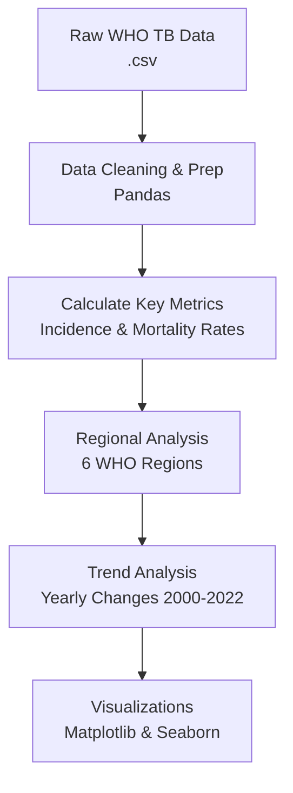

# Global Tuberculosis Data Analysis with Python

[](LICENSE)
[](https://www.python.org/)
[](https://jupyter.org/)
[](https://pandas.pydata.org/)
[](https://seaborn.pydata.org/)

An exploratory data analysis (EDA) project analyzing global tuberculosis (TB) surveillance data from the World Health Organization (WHO) between 2000 and 2022.

---

## Workflow Overview

The analysis covers data cleaning, calculating epidemiological metrics, analyzing regional differences, and creating visualizations in Python.



---

## Questions Explored

1. **Regional Distribution:** Which geographic regions account for the highest proportion of global TB cases?
2. **Long-Term Trends:** How have incidence and mortality rates changed over the past two decades?
3. **Mortality vs. Detection:** How does the mortality-to-incidence ratio differ between low-income and high-income regions?
4. **Recent Impact:** How did the 2020–2021 period affect case notifications and reporting?

---

## Project Structure

```text
Python_for_data_sci/
├── data/
│   ├── raw/                 # Downloaded WHO CSV data
│   └── processed/           # Cleaned data files
├── notebooks/
│   ├── 01_data_cleaning.ipynb
│   └── 02_exploratory_analysis.ipynb
├── src/
│   └── helpers.py           # Helper functions for plots and calculations
├── requirements.txt         # Python libraries
├── LICENSE
└── README.md
```

---

## Setup & How to Run

### 1. Set Up Environment

```bash
# Clone the repository
git clone https://github.com/Abdul3442/Python_for_data_sci.git
cd Python_for_data_sci

# Create a virtual environment
python3 -m venv venv
source venv/bin/activate

# Install dependencies
pip install -r requirements.txt
```

### 2. Launch Jupyter

```bash
jupyter lab
```

Open the notebooks in the `notebooks/` folder to run through the data cleaning and visualization steps.

---

## Key Observations

- **Regional Concentration:** Southeast Asia and Africa continue to carry the majority of the global burden, accounting for more than 65% of reported cases.
- **Progress Over Time:** Global incidence rates showed a gradual decline between 2000 and 2019, though progress varies significantly by country.
- **Reporting Disruptions:** Case notifications noticeably dipped in 2020, reflecting healthcare disruptions during the pandemic.

---

## Data Source

The dataset used in this project comes from the **World Health Organization (WHO) Global Tuberculosis Programme**:
- [WHO TB Data Portal](https://www.who.int/teams/global-tuberculosis-programme/data)

---

## License

This project is licensed under the [MIT License](LICENSE).
